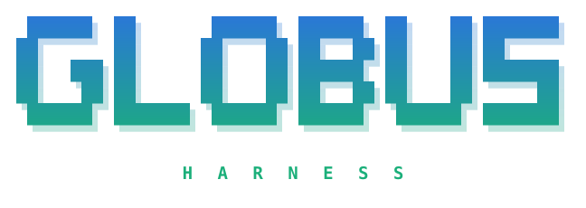

<p align="center"></p>

**A coding agent for research computing.** Globus Harness turns [Pi](https://pi.dev) into one
harness across the inference and compute a research lab actually has — the lab's own GPUs, the
ALCF inference gateway, Argonne's Argo gateway to frontier models, and supercomputers through
hpc-bridge — and shows you, all the time, which endpoint you are talking to, what it costs, and
whether anything is stuck.

## Set it up with your coding agent

Point any coding agent with shell access — Pi, Claude Code, Codex — at the setup runbook and let
it do the work:

> Set up Globus Harness on this machine by following
> https://github.com/GusEllerm/pi-lab-profile/blob/master/docs/agent-setup.md — work through it in
> order, run every check, and stop to ask me whenever a step needs something only I can do.

[docs/agent-setup.md](docs/agent-setup.md) is written for an agent: pinned versions with integrity
hashes, a check after every step, and the points where it must hand over to you — an account, a
login in your browser, a Duo push. It never asks for a password, and it merges into your existing
config rather than replacing it.

## What it is, and where it sits

Vendor harnesses such as Claude Code and Codex are built around one family of models. A research
lab's inference comes from several places at once, each with its own latency, cost and trust:

| | where it runs | what it is like |
|---|---|---|
| **Lab GPUs** | a vLLM server on the Globus Labs cluster, through an SSH tunnel | private, unmetered, shared by the whole lab |
| **ALCF gateway** | Argonne's inference service on Minerva, Metis and Sophia | many open-weight models; a cold one takes minutes to start |
| **Argo** | Argonne's gateway to Claude, GPT and Gemini, behind Duo | frontier models, **metered** |
| **HPC** | any facility in [hpc-bridge](https://github.com/globus-labs/hpc-bridge)'s registry | real compute, **billed** by the node-hour |

Pi is a small, open, model-agnostic terminal agent with an extension API, and Globus Harness is
built entirely on that API — a package of extensions plus one lab's configuration, not a fork. The
extensions work with any Pi provider; the lab configuration is the part another lab swaps.

## What you get

- **Know where every reply comes from.** A status column beside the transcript: context left and
  how fast it is filling, model and endpoint with ✓/✗ from its last reply, tokens and dollars,
  running agents. `/endpoints` probes every machine live — up, cold, queued. →
  [endpoints](docs/endpoints.md) · [observability](docs/observability.md)
- **Use several models on purpose.** Subagents you can watch, attach to, steer and move between
  endpoints mid-run; `/round` sends a change through dev → a two-model review panel → a critic. →
  [agents and rounds](docs/agents-and-rounds.md)
- **Know when something is stuck.** Every agent's wait is judged against what that wait usually
  takes, measured from hundreds of recorded sessions; `/stuck` shows the evidence. →
  [observability](docs/observability.md#is-it-stuck-stuck)
- **Frontier models with the meter visible.** Argo's models appear when you run `/argo up` (the
  Duo prompt comes into the chat), badged `⚡`, with the session's spend in the column. →
  [Argo](docs/argo.md)
- **Supercomputers as tools, with consent.** hpc-bridge lets the agent run on a cluster; a billed
  block starts only after you confirm a dialog, and headless runs cannot start one. →
  [HPC](docs/hpc.md)
- **Yours to shape.** The startup header is a file you edit; models per review role are a file you
  edit; the lab's configuration is a directory you copy. → [customising](docs/customising.md)

## Set it up yourself

```bash
npm install -g --ignore-scripts @earendil-works/pi-coding-agent@1.2.0
pi install npm:pi-cc-extensions@1.0.2
pi install npm:@tintinweb/pi-subagents@0.21.0
pi install git:github.com/GusEllerm/pi-lab-profile
git clone https://github.com/GusEllerm/pi-lab-profile && cd pi-lab-profile
scripts/install.sh lab        # Globus Labs members; anyone else: scripts/install.sh example
```

Then add `"tuiMode": "fullscreen"` to `~/.pi/agent/settings.json`. Outside the lab, point Pi at
your own model — a built-in provider or any OpenAI-compatible server: [providers.md](docs/providers.md).
In the lab, add the `pi()` launcher from [setup-guide §6](docs/setup-guide.md#6-the-launcher-function),
which opens the tunnel before Pi starts; each endpoint needs a credential only you can get, and the
[endpoints page](docs/endpoints.md#getting-access) says which, from whom, and how to check it.
[agent-setup.md](docs/agent-setup.md) is the same path with every check spelled out.

**No Node.js on the machine?** Build a bundle somewhere that has npm — Pi's standalone binary,
the harness and its packages with their dependencies in place — and install it with no npm at all:
[no-node.md](docs/no-node.md).

### Your first ten minutes

1. Run `pi`. The header names the model and endpoint; the column sits on the right.
2. `/endpoints` — every machine as a folder. → opens one, Enter on a model switches to it.
3. Ask something that uses tools, and watch the column: context filling, speed, the endpoint's ✓.
4. `/review` on a working tree with changes: two reviewers on different models, a critic who checks
   their claims, and the verdict back in the conversation.
5. While a subagent works, ↓ on an empty prompt focuses it in the list, Enter attaches, Esc
   comes back.
6. `/stuck` whenever something feels slow. Every command: [commands](docs/commands.md).

## Documentation

| | |
|---|---|
| [agent-setup.md](docs/agent-setup.md) | the setup runbook, for a coding agent or a careful human |
| [setup-guide.md](docs/setup-guide.md) | the long form: the reasoning behind each step, troubleshooting, undo |
| [providers.md](docs/providers.md) | your own model: a built-in provider or an OpenAI-compatible server |
| [no-node.md](docs/no-node.md) | installing on a machine without Node.js, from a bundle |
| [endpoints.md](docs/endpoints.md) | lab GPUs, ALCF, getting access, `/endpoints` |
| [argo.md](docs/argo.md) | the Argo gateway: the tunnel, Duo, spend |
| [agents-and-rounds.md](docs/agents-and-rounds.md) | the fleet, attach and steer, `/round` and choosing reviewer models |
| [observability.md](docs/observability.md) | the status column, `/stuck`, diagnostics |
| [hpc.md](docs/hpc.md) | hpc-bridge and the spend gate |
| [customising.md](docs/customising.md) | the header, pi-cc, the smaller things |
| [commands.md](docs/commands.md) | every command |
| [development.md](docs/development.md) | how it is built, what it depends on, working on it, the vault |

Verified on Pi 1.2.0 on macOS (October 2026) with pi-cc-extensions 1.0.2 and pi-subagents 0.21.0.
MIT licensed.
